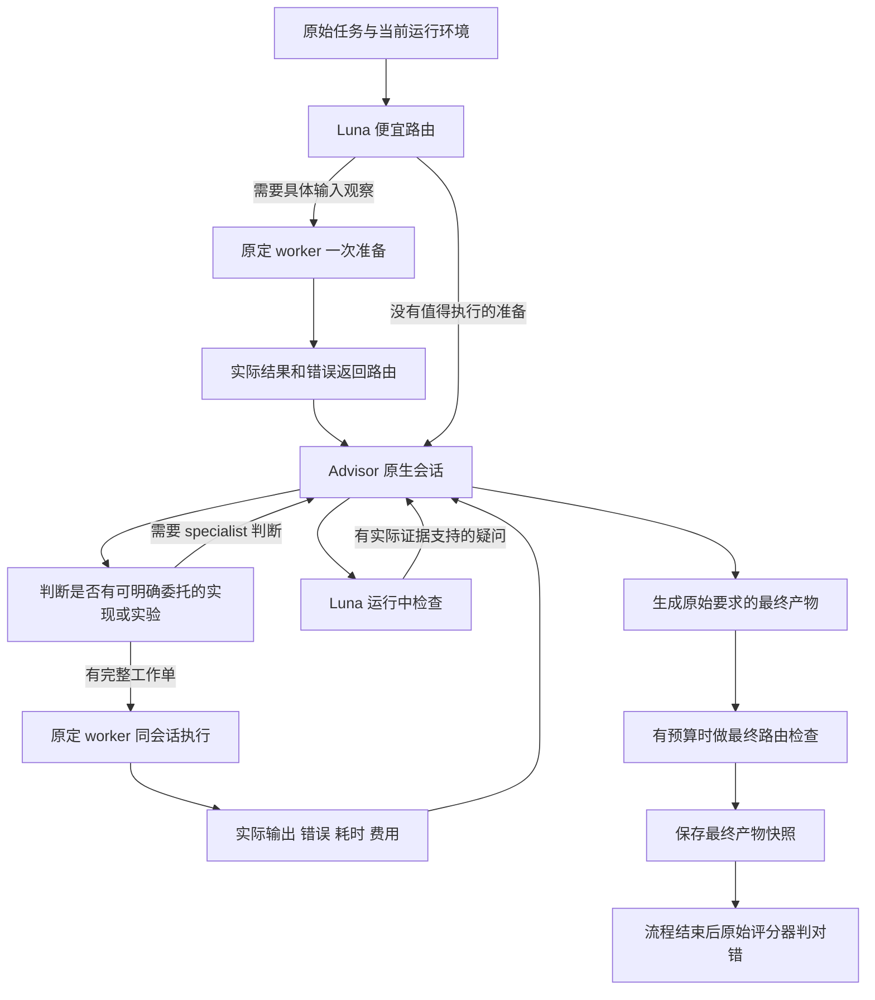

# Worker 与 Advisor 五题优化阶段性完整记录

结果截至 2026 年 10 月 14 日 02 时 07 分 39 秒 CDT。记录时区为 America/Chicago。文件名中的 `2026-10-13` 与 `20261014` 是既有实验目录和记录标识，部分时间戳按 UTC 保存，不能直接当作本地日期。

当前实验已按用户要求暂停，没有正在运行的评测。目标尚未完成：历史上 CAD、HOF、WAL 三种题目曾在不同版本成功，同一个冻结版本最多只证明两题成功，不能把不同版本拼成四题验收。SATB 尚未有混合流程全对的有效试次，ATRX 的本轮正确 advisor 单跑基线也未建立。

这份记录保留目标、验收标准、真实评分、费用、主要架构演变、已经证实的问题，以及暂停时未完成的代码。范围是五题 worker／advisor 架构实验，不是 T3 产品的全部 milestone 验收；这些评测 runtime 位于独立实验目录。

## 阅读顺序

先看目标与阶段结果，再看最新三版、成本分析和暂停状态。附录保留全部 79 条混合运行记录及另外 30 条基线、调试和回放账目，便于逐条回查。表格中的正确与错误来自原始评分记录；缺少最终结果和无效试次单独标注。

## 目标与当前验收标准

用户的目标是让便宜模型承担实际 worker 工作，让更强模型在执行过程中处理困难问题，五题至少四题做对，同时显著降低相对 advisor 独立完成的费用。求助应发生在真实开发与执行过程中，不依赖评分器判错之后再请求 advisor，也不在任务流程里加入人的批准步骤。

用户后续明确接受的标准是：

1. 五题中至少四题通过原始评分器。
2. 通过的题目使用同一个冻结实现和固定模型分工。
3. 每道成功题相对正确的同题 advisor 单跑至少节省 25%。
4. 成功题加权合计至少节省 30%。
5. 保留开发、失败、修复和超额调用的费用；缺失用量不按零处理。

单题节省率为 `1 - 混合费用 / 正确 advisor 单跑费用`。成功题合计节省率为 `1 - 成功题混合费用之和 / 对应正确 advisor 单跑费用之和`，不是把各题百分比做简单平均。

早期原始清单中的每题 30% 和所有五题合计条件已经被用户后续确认的条件取代。旧报告仍保留历史口径；当前验收以 `acceptance-policy-20261014.json` 与 `acceptance_report.py` 为准。错误题即便价格更低，也不能作为成功节省的验收证据。

验收依据：[用户确认的验收条件](../acceptance-policy-20261014.json)；[当前验收计算](../acceptance_report.py)。

## 模型分工与评测环境

| 题目 | 实际 worker | 实际 advisor | decision |
|---|---|---|---|
| cad-model | cursor/grok-4.7-low · low | gpt-6.1-sol · high | gpt-6-luna · medium |
| hof-topology-interpenetration | cursor/grok-4.7-low · low | gpt-6.1-sol · high | gpt-6-luna · medium |
| satb-audio-transcription | cursor/grok-4.7-low · low | gpt-6.1-sol · high | gpt-6-luna · medium |
| atrx-vep-crispr | gpt-6-luna · medium | cursor/grok-4.7-high · high | gpt-6-luna · medium |
| wal-recovery-ordering | gpt-6-luna · medium | cursor/grok-4.7-high · high | gpt-6-luna · medium |

Grok 通过 Cursor SDK 调用，GPT 通过本机原生 Codex 接口调用。公开筛题数据中 Grok Medium、Luna Max 的成绩只是筛题线索，不能当作本地 High advisor 或 Medium worker 的重复实测成绩。模型名称和 effort 在冻结清单中记录。

评测由 Harbor 执行，使用 Daytona 云端容器，避免把 macOS ARM64 的环境兼容问题混入主要对错判断。任务串行运行，每份配置一个 attempt、一个并发 trial、自动重试为零。原始题目与评分器固定，最近版本审计覆盖 98 个原始任务文件。Harbor 版本为 0.24.0，Cursor SDK 为 1.0.37，Codex CLI 为 0.162.0-alpha.17.2。

求解模型只接收原始任务、当前工作区文件和实际公开执行结果。评分器在任务流程结束后运行，不把其对错反馈、历史解答代码、历史任务答案或私有推理文本注入新一轮求解。费用中的 reasoning token 数是用量元数据，不是读取模型私有推理内容。

分工与来源清单：[原始实验清单](../manifest.json)；最新已验证实现：[V56 冻结清单](../raw/candidates/v56/manifest.json)。

## 本地 advisor 独立完成基线

| 题目 | advisor | 原始评分 | 结果 | 完整模型费用 |
|---|---|---|---|---:|
| [cad-model](../raw/jobs/solo-cad-model/cad-model__tKoUz92/result.json) | gpt-6.1-sol high | 8/8 | 正确 | $0.18771240 |
| [hof-topology-interpenetration](../raw/jobs/solo-hof-topology-interpenetration/hof-topology-interpenetration__ck6Xzt2/result.json) | gpt-6.1-sol high | 38/38 | 正确 | $0.33034600 |
| [satb-audio-transcription](../raw/jobs/solo-satb-audio-transcription/satb-audio-transcription__AEaYs7b/result.json) | gpt-6.1-sol high | 40/40 | 正确 | $0.46458160 |
| [atrx-vep-crispr](../raw/jobs/solo-atrx-vep-crispr/atrx-vep-crispr__d2mL9vv/result.json) | Grok 4.7 256K High | 8/16 | 错误 | $1.54501800 |
| [wal-recovery-ordering](../raw/jobs/solo-wal-recovery-ordering/wal-recovery-ordering__4Uq3wWq/result.json) | Grok 4.7 256K High | 97/97 | 正确 | $1.59167400 |

五条单跑基线合计 $4.11933200。这是五个独立实际试次，不是本轮反复抽样后的稳定成功率证明。

ATRX 的 Grok High 单跑是 8/16，费用 $1.54501800。因此目前不能拿它作为“正确完成该题”的费用基线。将 ATRX 混合费用与这条失败单跑相比，可以描述支出差异，但不能宣称成功题节省或据此通过验收。

## 已取得的结果与未完成的要求

| 题目 | 版本 | 原始评分 | 结果 | 混合费用 | 对正确单跑的节省 |
|---|---|---|---|---:|---:|
| cad-model | [V31](../raw/jobs/hybrid-v31-cad-model/cad-model__6oHJnda/result.json) | 8/8 | 正确 | $0.13235040 | 29.49% |
| hof-topology-interpenetration | [V31](../raw/jobs/hybrid-v31-hof-topology-interpenetration/hof-topology-interpenetration__iNPK7He/result.json) | 38/38 | 正确 | $0.23327500 | 29.38% |
| wal-recovery-ordering | [V10](../raw/jobs/hybrid-v10-wal-recovery-ordering/wal-recovery-ordering__dr4ugTY/result.json) | 97/97 | 正确 | $0.56939986 | 64.23% |
| satb-audio-transcription | [V56](../raw/jobs/hybrid-v56-satb-audio-transcription/satb-audio-transcription__DgieixB/result.json) | 26/40 | 错误 | $0.33618430 | 27.64%，错误题不验收 |
| atrx-vep-crispr | [V10](../raw/jobs/hybrid-v10-atrx-vep-crispr/atrx-vep-crispr__fyaBzSf/result.json) | 0/16 | 错误 | $1.23543924 | 不具备正确基线 |

上表用于说明历史进展和最新问题，不能把 V10、V31、V56 合并成一个成功候选。

V31 是目前同版成功题最多的版本：CAD 8/8 与 HOF 38/38。两题分别节省 29.49% 和 29.38%，满足每题 25%；合计混合费用 $0.36562540，对应单跑合计 $0.51805840，加权节省 29.42%，尚未达到合计 30%。该版本 SATB 为 29/40，WAL 与 ATRX 没有形成该候选的完成结果，不能把未运行当作错误或正在运行。

CAD 历史最低的正确混合费用出现在 V9，为 $0.13099670，节省 30.21%；它与 V31 的双题成功属于不同版本。WAL V10 的 97/97 和 64.23% 节省证明该题曾在混合流程成功，但不是最近版本的同版证据。

SATB 的历史最好结果是 V27、V48 各 37/40，仍然错误。最近 V54、V55、V56 分别为 24/40、33/40、26/40，没有显示可靠的持续改善。后期主要定位了编排、预算和成本问题，尚未把这些修复转化成 SATB 全对。

同版验收依据：[V31 验收结果](../acceptance-v31.json)；[V31 审计](../audit-v31.json)。

## 最新 V54 至 V56 的逐版记录

| 版本 | 完成时间 CDT | 原始评分 | 总费用 | 单跑费用节省 | 主要改动 |
|---|---|---|---:|---:|---|
| V54 | 2026-10-14 01:16:32 CDT | 24/40，错误 | $0.34169050 | 26.45% | Luna 先路由，按需调用初始 worker |
| V55 | 2026-10-14 01:34:13 CDT | 33/40，错误 | $0.33690800 | 27.48% | 延长同一个 worker 调用的等待间隔，并提高工具结果输出上限 |
| V56 | 2026-10-14 02:07:39 CDT | 26/40，错误 | $0.33618430 | 27.64% | 委托加入执行计划，记录实际命令耗时与超时标记 |

### V54 先用便宜的路由判断

此前最近八版的初始 Grok 判断都未执行命令便请求 advisor，每次约 $0.018 至 $0.020。V54 先让 Luna 看完整原始任务、原始图片和实际运行环境：有具体、值得执行的输入观察时才请求一次初始 worker，否则直接进入 advisor。

本次初始路由花费 $0.00111170，没有初始 Grok 调用。Sol 在执行中仍调用了原定 Grok worker，因此没有把 worker 角色换成 Luna。费用明细为：worker $0.04380800，decision $0.00395410，advisor $0.29392840，总计 $0.34169050。Sol 触及预算边界，最终 SATB 24/40。

记录还发现 Sol 等待 worker 时进行了七次 10 秒查询。与这些 wait 工具调用对应的七次响应合计 $0.02445600；最后返回工具输出时出现截断。这个费用包括对应响应中的其他输出或推理，不是 wait 函数本身单独收费，也不能假定它全部可避免。

### V55 改善同一个调用的等待与完整返回

V55 给原生接口中的 worker 调用增加指导：单独一个 functions.exec 调用，最多等待 60 秒，输出上限 12000 tokens；仍在运行时等待同一个 cell，不再次发起 worker。Cursor 的直接 custom tool 则继续直接 await，不构造不存在的 wrapper 工具。

实际调用遵守了这个指导，工具返回约 5098 字符，没有 wrapper 截断。六次 wait 对应响应合计 $0.01995920。但这次 worker 的第二条命令运行满 300 秒后退出 124，Sol 收到真实错误后继续处理。计算超时和不同工作负载使两次总费用不构成严格的等待机制对照实验。

费用明细为：worker $0.05594400，decision $0.00701240，advisor $0.27395160，总计 $0.33690800；最终 SATB 33/40。等待方式改善被实际验证，任务正确性仍未通过。

排查发现 Sol 的后续修复同时改变了一项二次增长计算的实现、复用了已生成数据并限制了数值库线程。后续命令只需数秒，但有代码与工作负载变化，不能将 300 秒与数秒的差异全部归因于线程限制。

### V56 明确执行规模并记录真实耗时

V56 要求 routine_worker 工作单包含 execution_plan：已观察的输入规模或如何测量、主要耗时和内存增长、可以复用的当前中间数据、必要的短耗时可行性检查。短检查只判断计算是否可行，不能替代完整原始输入或正确性验证。

本轮 advisor 给出了这份计划，worker 的两条命令均退出 0。controller 实测等待时间分别为 1.395840 秒与 3.392962 秒，无命令超时；该时间包含远端执行和传输等待，不含 worker 模型推理。

实际 Grok 调用费用却升至 $0.12262400，超过 $0.037166528 的工作单目标。原生费用只在已返回用量的边界可知，目标不能当作单次调用的硬账单上限。Sol 费用为 $0.21251920，初始路由 $0.00104110，零模型 literal executor 费用为零，总计 $0.33618430。Sol 在预算边界被中断，最终 SATB 26/40。

执行计划和耗时记录已经走通；“计算跑得快”没有自动变成“模型费用低”，更没有证明题目做对。不同单次运行的轨迹有差异，不能仅凭 33/40 降到 26/40 判断执行计划导致准确率下降。

最新证据：[V54 诊断](../raw/v54-satb-optional-discovery-diagnostic.json)；[V55 诊断](../raw/v55-satb-worker-await-diagnostic.json)；[V56 诊断](../raw/v56-satb-execution-plan-diagnostic.json)。

## 便宜 worker 为什么没有稳定带来总费用下降

### 单价优势与 token 数量是两回事

总费用包括 worker、decision、advisor、修复和等待相关模型响应。只看 worker 每百万 tokens 的单价，不能推断整条任务的费用。

V56 的 Grok 原生用量与费用分解如下。reasoningTokens 是 outputTokens 的子集，拆分只用于解释费用，没有再加一次：

| 用量部分 | tokens | 使用的每百万 tokens 价格 | 折算费用 |
|---|---:|---:|---:|
| 新输入 | 7626 | $2.00 | $0.01525200 |
| 缓存读取 | 2560 | $0.50 | $0.00128000 |
| 输出合计 | 17682 | $6.00 | $0.10609200 |
| 输出中的 reasoning 子集 | 13623 | $6.00 | $0.08173800，已包含在上行 |
| 输出扣除 reasoning 后的其余部分 | 4059 | $6.00 | $0.02435400，已包含在输出合计 |
| 正确合计 | — | — | $0.12262400 |

reasoning 折算约占本次 worker 费用的 66.66%。这支持一个具体判断：本次 worker 费用主要花在模型推理与生成，不能用命令只运行数秒来解释账单。Low effort 也不是一个固定的 reasoning token 数上限。

### Advisor 仍承担大量核心工作

worker 产物如果只是初步观察、通用组件或尚待解释的实验数据，advisor 仍需建立模型、处理不确定性、修改实现和进行语义检查。此时 worker 费用是在 advisor 工作之前新增的支出，只有替代了原本要由 advisor 完成的有效工作，才可能稳定省钱。

本轮已经做到 worker 在 advisor 活跃会话内真正执行并返回结果，但还没有证明这些委托足够减少 SATB 的核心工作量。V56 也显示，一个更大的工作单可能快速执行，却带来大量 worker reasoning tokens。

### 上下文和等待产生额外费用

早期工作结果在多个字段重复出现，包括 commands、文本中的 actual_command_results 和 protocol_history。V53 保存完整当前证据文件，返回不重复的实际输出、退出码和代码摘要；V53 的实际返回从 26944 字符减少到 6740 字符，减少约 75%。这是证据传递机制的验证，不是整题节省 75%。

V54 省掉了重复初始判断，V55 减少了频繁等待和输出截断。两者都减少了明确的编排浪费，但没有消除 worker 自身的推理量，也没有让 advisor 自动跳过核心求解。

### 预算中断可能先于完成

最近版本的整题目标为正确单跑费用的 72%，留出约 28% 目标节省。按原生响应或 SDK turn 边界读取费用，单次响应可能超额，全部超额仍记录。

SATB 正确单跑为 $0.46458160，72% 目标为 $0.334498752。V54、V55、V56 的实际总费用都略高于这个目标，并在预算边界结束。不能用预算限制制造价格更低但答错的结果，然后称为成功优化；当前记录将其列为错误且不验收。

费用与传递证据：[V56 原生用量诊断](../raw/v56-satb-execution-plan-diagnostic.json)；[V54 等待用量归属](../raw/v54-worker-wait-overhead-metadata.json)；[V55 等待用量归属](../raw/v55-worker-wait-overhead-metadata.json)；[V53 证据返回诊断](../raw/v53-satb-worker-evidence-once-diagnostic.json)。

## 最新已评测流程与求助机制

以下流程对应 V56。它已经真实运行，不代表已通过任务正确性验收。

worker 可在输入缺失、算法细节未明确、实际命令失败或实验结果与假设冲突时报告 needs_advisor。实验假设被否定是有效观察，不应伪造成功。advisor 可以解释真实结果、补充缺失方法并在当前工作区继续处理。这里没有人的批准步骤，也没有运行中的隐藏评分。

routine_worker 返回当前任务的证据，绑定实际 advisor thread 与 turn。相同调用去重，避免重复执行付费 worker；保留失败、未执行命令、原始费用和全量证据。上行返回的简化证据不构成语义正确证明，完整证据仍在当前工作区可读。

关键限制包括：最多两个 advisor 干预；每个 advisor 干预最多一次付费 in-turn worker 调用；该调用一个模型 turn、最多两条远端命令；命令期限 300 秒；整题费用共享同一目标。worker 目标额度为 solo 的 8%，continuation reserve 为 solo 的 4%，这些是分配与边界估计，不是 provider 强制 token 上限。可选初始准备目标为 solo 的 4%。

Sol 端保留异步通知和预算监控。Cursor 端显式排斥 worker 与 remote_command 同时操作工作区。Sol 端目前主要依靠调用指导等待 worker，并没有证明已经实现同等强制的工作区互斥；不能宣称两个 provider 都有严格串行锁。

完成 advisor 干预后，controller 可以字面执行明确的 delivery 命令，不进行额外模型推理；这种 executor 的模型费用为零，不能把它当成额外模型完成的工作。没有足够预算时，最终路由或运行中检查可能未执行，记录会如实保留。

流程源文件：[V56 coordinator](../v56_runtime/coordinator.py)；[V56 delegation](../v56_runtime/delegation.py)；[V56 命令观察](../v56_runtime/execution.py)；[V56 证据返回](../v56_runtime/worker_evidence.py)。

## 主要架构演变与各阶段收获

| 阶段 | 主要方向 | 结果与限制 | 冻结依据 |
|---|---|---|---|
| V1 至 V8 | 结构化 advisor 回复与修复交付 | 恢复完整公开回复、区分图片与文本、避免准备阶段抢占预算、增加有依据的有限修复；部分 CAD 成功但费用和正确性不稳定。 | [清单](../raw/candidates/v8/manifest.json) |
| V9 至 V12 | Advisor 原生访问共享工作区 | Advisor 能直接读文件、运行命令和修复，不强制弱 worker 重建；修复无命令额度仍继续推理和 SSH 监督问题。V10 WAL 成功，早期若干 transport/provider 失败仍保留。 | [清单](../raw/candidates/v9/manifest.json) |
| V13 至 V20 | 控制 worker 的实际作用和范围 | 尝试原生 worker、Luna 前置规划、机械准备、精简观察和一次有限修复；避免 worker 在缺少 specialist 判断时自行猜解。边界提示仍不能保证单次调用低费用。 | [清单](../raw/candidates/v20/manifest.json) |
| V21 | 放宽执行预算的单独实验 | 执行目标放宽到 solo 的 90%，外部节省条件仍保留；没有证明满足原有成本要求，后续没有把放宽预算作为完成证明。 | [清单](../raw/candidates/v21/manifest.json) |
| V22 至 V31 | 原始任务所有权和明确完成状态 | 减少额外形式要求；改进 task-scoped delivery、同会话证据引用和完成状态；先完整草稿后拆分组件；V31 CAD 与 HOF 同版成功。 | [清单](../raw/candidates/v31/manifest.json) |
| V32 至 V38 | 保留快照并聚焦纠错证据 | 增加产物快照和独立回放诊断、具体不确定性、未完成进度；比较连续预算、预留纠错预算和新上下文。回放不反馈给 solver。 | [清单](../raw/candidates/v38/manifest.json) |
| V39 至 V45 | 调整预算和组件实现 | 整题目标改为 solo 的 72%；恢复原生默认角色；探索完整组件与库适配；增加严格 shell，保留失败。更多组件代码未稳定带来正确率。 | [清单](../raw/candidates/v45/manifest.json) |
| V46 至 V47 | Advisor 先确定核心 再可选交接 | 初始判断缩至 solo 的 4%；后置交接必须有当前输入文件与哈希；移除假想 worker 预留造成的过早 advisor 中断。 | [清单](../raw/candidates/v47/manifest.json) |
| V48 至 V50 | 活跃会话中的便宜检查 | 一次 Luna 检查从 50% 移到 65%；原生 Sol 在同一个 turn 接收反馈，Cursor 在已有 turn 边界继续；检查区分原始观察与自洽验证。 | [清单](../raw/candidates/v50/manifest.json) |
| V51 至 V52 | Advisor 执行中真实调用 worker | 注册 routine_worker，保留同 thread/turn、请求去重和全部费用；允许在 specialist 结论未确定时委托有明确方法的实验。V51 工具未被使用，V52 实际调用。 | [清单](../raw/candidates/v52/manifest.json) |
| V53 | 减少重复证据 | 全量当前证据可回查，简化返回不重复实际命令记录；负面证据、重复执行次数和错误继续保留。 | [清单](../raw/candidates/v53/manifest.json) |
| V54 | 便宜路由先行 | 取消强制付费初始 Grok 判断；需要具体输入观察时才调用原定 worker。 | [清单](../raw/candidates/v54/manifest.json) |
| V55 | 同一调用长间隔等待 | 实际遵循 60 秒等待和较大输出上限，完整返回；出现 300 秒计算超时，后续由 advisor 处理。 | [清单](../raw/candidates/v55/manifest.json) |
| V56 | 执行计划与耗时证据 | worker 命令数秒完成，但本次 reasoning tokens 大幅增加；发现运行中检查与 worker 费用的预算条件不一致。 | [清单](../raw/candidates/v56/manifest.json) |

这些版本多数不是在同一随机轨迹和相同成本分配下做的受控对照。单次评分差异只能说明该次结果，不足以证明某项改动导致提升或下降。冻结版本和实际试次用于回查，不代表每个版本都完整运行了五题。

## 已确认的预算条件缺陷与 V57 暂停状态

### V56 中的缺陷

预算监控扣除 worker 实际费用后限制 advisor 剩余支出，但运行中 Luna 检查比较的仍是 `advisor 自身费用 >= 干预原始预算 × 65%`。worker 费用较高时，advisor 会在自身费用达到这个阈值之前耗尽共享预算。

V56 的原始检查阈值约为 $0.2134974738；advisor 最终费用为 $0.2125192000，worker 为 $0.1226240000，两者合计 $0.3351432000。运行中检查记录 attempts 为 0。这与代码中的原生费用单独比较条件一致，解释了为何总预算已耗尽而检查未启动。

它是编排预算条件的缺陷，不证明修正后 SATB 一定能全对，也不能回溯扣掉本次费用。

### V57 只写了一部分

暂停前已经开始在 V57 草稿中修改：检查阈值使用 advisor 原生费用加已完成 worker 的实际费用；worker 返回后也检查触发，避免依赖下一次用量事件；尚未结算的预留额度不当作已花费用；记录触发时 advisor、worker 与合计费用。

当前文件状态为：

| 部分 | 暂停时状态 |
|---|---|
| native.py | 已写入部分阈值修改和完成后触发代码，未验证 |
| cursor_review.mjs | 已写入合计费用判断，未验证 |
| agent.py 与 live_review.py | 已写入部分说明与字段修改，未验证 |
| sdk.py 和 audit_v57.py | 尚未完成新触发口径的接线与审计更新 |
| V57 测试 | 从旧版复制的文件不能当作新版测试已通过；未执行新版验证 |
| V57 冻结清单 | 不存在 |
| V57 付费评测 | 没有启动，无 launch-once 记录 |

恢复工作时，不能直接把 V57 当成已验证版本，也不能把 V56 的审计成绩用于证明 V57。

依据：[V56 预算与用量诊断](../raw/v56-satb-execution-plan-diagnostic.json)；[V56 原生检查代码](../v56_runtime/native.py)；[V57 原生草稿](../v57_runtime/native.py)；[暂停状态](../ACTIVE_RUNS.json)。

## 费用账本与计算口径

| 类别 | 记录数 | 已知费用 | 完整费用未知记录数 |
|---|---:|---:|---:|
| 混合 worker／advisor 试次 | 79 | $27.41358018 | 6 |
| 同题 advisor 单跑基线 | 5 | $4.11933200 | 0 |
| 开发与协议探测 | 15 | $0.44915928 | 2 |
| 快照回放与相关诊断 | 10 | $0.00000000 | 2 |
| 合计 | 109 | $31.98207146 | 10 |

79 条混合记录分布为 CAD 15、HOF 17、SATB 41、ATRX 3、WAL 3。账本与现有结果分类器给出 9 条正确、63 条错误、6 条无效、1 条缺少最终结果。9 条正确来自 7 条 CAD、1 条 HOF、1 条 WAL，代表试次而非九种不同题目。

这些分类不能直接计算模型成功率：版本、配置和任务分配发生变化，部分原始错误分数受 transport 失败影响，无最终结果也不等于模型错误。

费用采用本轮冻结使用的模型原生 token 计数与标准价格参数折算，不是订阅发票，不反映已领额度实际如何扣款；不含 Daytona 基础设施、外层架构开发 agent 工作和未报告的工具附加费。下面价格是本轮使用的历史参数，不是对当前官网报价的重新核验。

| 模型 | 新输入每百万 tokens | 缓存读取 | 缓存写入 | 输出含 reasoning |
|---|---:|---:|---:|---:|
| GPT 6 Luna | $0.10 | $0.01 | $0.125 | $0.50 |
| GPT 6.1 Sol | $2.00 | $0.10 | $2.50 | $10.00 |
| Grok 4.7 | $2.00 | $0.50 | 未提供可用参数 | $6.00 |

Codex input 计数包含缓存，计算新输入时扣除缓存读取和写入。Cursor 的 fresh input 与 cache 计数是分开的，不能再次扣除缓存。reasoning 是输出子集，不能重复收费。缺少必要用量会保留未知，不能为了报告完整而补成零。

本轮共有 10 条记录缺少完整费用。其中部分已知子调用费用已经计入已知总额，其余仍未知。历史费用分类中的 unknown_or_pending 是费用不完整标记，不代表现在有活动进程。零模型 literal executor、完整零模型 replay 或注册测试只有在明确没有模型调用时才可记模型费为零；容器费用仍不在这份模型账本内。

要读取更新后的完整账本，应使用 `expenses_v51.py` 的口径，它包含后期原生工具探测；旧 collector 可能遗漏后加的探测记录。暂停期间只读取已有账本，没有重新运行评测或发生新的 solver 模型调用。

账本：[完整费用记录](../expenses.json)；[原生价格与用量计算](../routing.py)；[后期费用汇总器](../expenses_v51.py)。

## 真实性验证与不能支持的结论

最近 V54、V55、V56 均由原始评分器完成，exception 为 null。源代码审计分别检查 991、1024、1059 个冻结文件及 98 个原始任务文件，问题列表为空。冻结文件数包含候选清单保护的历史依赖和配置，不等于当前执行代码文件数或测试覆盖率。最终 /app/score.musicxml 快照与评分时下载的产物哈希相同。

这些审计证明记录完整性、输入与源码边界和费用的一致性，不证明模型答案正确。正确性必须看原始评分器；存在文件、哈希相同、XML 可解析、命令退出 0 或模型声称 completed，都不能替代语义验收。

本地测试证明了预算记账、请求去重、实际失败保留、同会话返回、输出简化和命令观察等机制。V56 有 57 个唯一 Python 测试，因导入测试类重复发现共执行 66 次，另有 Cursor worker 与 review 的 JavaScript 检查。不能把 66 当成 66 项互不重复的测试，也不能把机制测试通过当成 SATB 通过。

对代码规模的本地合成探测使用了随机数据，显示数学等价算法的执行时间可能相差很大，但它运行在 macOS ARM64，不是 Daytona 性能结果，也不含原始题目数据，不能当作评分证据。

早期无效试次和 transport 问题保留。例如 V10 HOF、V14 HOF 的 worker 启动失败没有形成有效答案；V11 SATB 虽有原始错误评分，执行过程中出现三次连接拒绝，其分数不能单独证明模型能力。最新三版的命令错误与超时作为真实执行证据返回 advisor，评分则继续区分真正的对与错。

| 版本 | 原始任务文件数 | 冻结文件数 | 最终产物字节数 | SHA256 |
|---|---:|---:|---:|---|
| V54 | 98 | 991 | 162186 | `a9bb2342a3d631acf4895137f9338a6f4e946cad3322ff75530f727ae82c92b8` |
| V55 | 98 | 1024 | 144477 | `6f1b32dc6a6cb0d2cfb132b9b3bee9c7879e25b3008b564dc68da0928e176b2a` |
| V56 | 98 | 1059 | 162619 | `0de1015439c0c3e39b34e62325e71543cce83cd41930990c1cf8d8dd84af11e8` |

审计依据：[V54 审计](../audit-v54.json)；[V55 审计](../audit-v55.json)；[V56 审计](../audit-v56.json)；[V11 transport 诊断](../raw/v11-satb-transport-diagnostic.json)。

## 暂停与剩余授权

用户明确要求先暂停尝试，随后要求详细记录。当前目标状态是 paused；新评测、付费 solver 调用和 V57 实现继续工作均停止。记录撰写只整理现有源文件、分数、费用和状态，没有启动新的 benchmark。

旧的一次 WAL 与一次 ATRX 重跑授权已经用于 V10。后续新增的一次 WAL 仍未使用，条件是 SATB 先通过原始评分器，且 WAL 使用同一个冻结候选。最新 SATB V56 为 26/40，条件未满足。ATRX 当前没有新增试次授权。

若之后恢复，已有条件授权也不能被解释为无条件 WAL 重跑，更不能把自动 goal 续跑当作新的付费试次授权。

授权依据：[旧 WAL 与 ATRX 授权及消费记录](../authorization-wal-atrx-20261013.json)；[新增条件 WAL 授权](../authorization-conditional-wal-20261014.json)；[当前暂停状态](../ACTIVE_RUNS.json)。

## 恢复工作时的待办顺序

以下是暂停时的待办，不表示已经执行，也不授权现在启动。

1. 检查 V57 草稿的预算触发修改，补齐 SDK、审计字段与有行为意义的测试。验证合计真实费用触发、预留费用不误触发、worker 完成后无需等待额外用量事件、一次检查和同 thread/turn 反馈，以及未知用量时停止。
2. 进一步明确适合弱 worker 的工作单。重点是让 advisor 先确定必要算法选择，避免把方案取舍和高不确定性研究转给 worker，同时保持 worker 真正承担可替代的实现工作。
3. 保留已有的重复判断清理、完整证据返回、较长等待和执行耗时记录。它们修复了明确的开销和可观察性问题，但不能预设它们能提高最终分数。
4. 对一个冻结新候选做有明确假设的 SATB 验证；不能将同一候选反复抽样直到通过，并只报告最好的一次。
5. 若 SATB 真正通过，再按已有条件授权用同一候选跑一次 WAL；CAD 与 HOF 也需在同一新候选形成有效成功记录。
6. 完成同版至少四题、每题至少 25%、成功题加权至少 30% 的完整验收与费用审计后，才能宣称目标完成。历史 V31 或 V10 的成功只作历史证据，不能代替新候选结果。

## 附录一 所有正确试次及费用

| 题目 | 版本 | 原始评分 | 模型费用 | 节省率 | 单题 25% 条件 | 证据 |
|---|---|---|---:|---:|---|---|
| cad-model | V4 | 8/8 | $0.19564990 | -4.23% | 不满足 | [原始结果](../raw/jobs/hybrid-v4-cad-model/cad-model__2bc7WH9/result.json) |
| cad-model | V6 | 8/8 | $0.15524934 | 17.29% | 不满足 | [原始结果](../raw/jobs/hybrid-v6-cad-model/cad-model__RXXRpT6/result.json) |
| cad-model | V7 | 8/8 | $0.18701300 | 0.37% | 不满足 | [原始结果](../raw/jobs/hybrid-v7-cad-model/cad-model__sjJHJdJ/result.json) |
| cad-model | V8 | 8/8 | $0.14074960 | 25.02% | 满足 | [原始结果](../raw/jobs/hybrid-v8-cad-model/cad-model__D3pFZg3/result.json) |
| cad-model | V9 | 8/8 | $0.13099670 | 30.21% | 满足 | [原始结果](../raw/jobs/hybrid-v9-cad-model/cad-model__YZtzm9i/result.json) |
| wal-recovery-ordering | V10 | 97/97 | $0.56939986 | 64.23% | 满足 | [原始结果](../raw/jobs/hybrid-v10-wal-recovery-ordering/wal-recovery-ordering__dr4ugTY/result.json) |
| cad-model | V16 | 8/8 | $0.13495610 | 28.10% | 满足 | [原始结果](../raw/jobs/hybrid-v16-cad-model/cad-model__7BfNFMw/result.json) |
| cad-model | V31 | 8/8 | $0.13235040 | 29.49% | 满足 | [原始结果](../raw/jobs/hybrid-v31-cad-model/cad-model__6oHJnda/result.json) |
| hof-topology-interpenetration | V31 | 38/38 | $0.23327500 | 29.38% | 满足 | [原始结果](../raw/jobs/hybrid-v31-hof-topology-interpenetration/hof-topology-interpenetration__iNPK7He/result.json) |

这里每行都是真实正确试次；只有价格条件满足的行才能进一步进入同版整体验收。正确本身不意味着便宜，某些早期 CAD 正确试次比单跑还贵。

## 附录二 全部 79 条混合运行记录

费用以完整账本为准。完整费用缺失时显示已知下界，`≥ $0` 表示只掌握零金额下界，不是该试次免费。错误试次的节省率只描述相对支出，不参与成功验收。表格按版本数字和题目排序，并非实际启动时间排序。

| 序号 | 版本 | 题目 | 原始评分 | 状态 | 模型费或已知下界 | 支出节省率 | 结果证据 |
|---:|---|---|---|---|---:|---:|---|
| 1 | V1 | cad-model | 6/8 | 错误 | $0.44204526 | -135.49% | [记录](../raw/jobs/hybrid-v1-cad-model/cad-model__aoBU7m4/result.json) |
| 2 | V1 | atrx-vep-crispr | 0/16 | 错误 | $2.53846718 | — | [记录](../raw/jobs/hybrid-v1-atrx-vep-crispr/atrx-vep-crispr__5GY387C/result.json) |
| 3 | V1 | wal-recovery-ordering | 95/97 | 错误 | $0.88937944 | 44.12% | [记录](../raw/jobs/hybrid-v1-wal-recovery-ordering/wal-recovery-ordering__bsW3Mey/result.json) |
| 4 | V2 | atrx-vep-crispr | 无最终分数 | 无效试次 | ≥ $0.02681470，完整值未知 | — | [记录](../raw/jobs/hybrid-v2-atrx-vep-crispr/atrx-vep-crispr__Ya88d4X/result.json) |
| 5 | V2 | wal-recovery-ordering | 95/97 | 错误 | $1.17491776 | 26.18% | [记录](../raw/jobs/hybrid-v2-wal-recovery-ordering/wal-recovery-ordering__K6odaSA/result.json) |
| 6 | V3 | cad-model | 0/8 | 错误 | $0.10772736 | 42.61% | [记录](../raw/jobs/hybrid-v3-cad-model/cad-model__YcfRiCJ/result.json) |
| 7 | V3 | hof-topology-interpenetration | 0/38 | 错误 | $0.30206650 | 8.56% | [记录](../raw/jobs/hybrid-v3-hof-topology-interpenetration/hof-topology-interpenetration__c7DSAjG/result.json) |
| 8 | V3 | satb-audio-transcription | 1/40 | 错误 | $0.40783896 | 12.21% | [记录](../raw/jobs/hybrid-v3-satb-audio-transcription/satb-audio-transcription__DtNKqNU/result.json) |
| 9 | V4 | cad-model | 8/8 | 正确 | $0.19564990 | -4.23% | [记录](../raw/jobs/hybrid-v4-cad-model/cad-model__2bc7WH9/result.json) |
| 10 | V4 | hof-topology-interpenetration | 35/38 | 错误 | $0.88390650 | -167.57% | [记录](../raw/jobs/hybrid-v4-hof-topology-interpenetration/hof-topology-interpenetration__ZKs8Vty/result.json) |
| 11 | V5 | cad-model | 2/8 | 错误 | $1.32187386 | -604.20% | [记录](../raw/jobs/hybrid-v5-cad-model/cad-model__maqA5Zw/result.json) |
| 12 | V6 | cad-model | 8/8 | 正确 | $0.15524934 | 17.29% | [记录](../raw/jobs/hybrid-v6-cad-model/cad-model__RXXRpT6/result.json) |
| 13 | V6 | hof-topology-interpenetration | 0/38 | 错误 | $0.23688030 | 28.29% | [记录](../raw/jobs/hybrid-v6-hof-topology-interpenetration/hof-topology-interpenetration__B6oY944/result.json) |
| 14 | V6 | satb-audio-transcription | 1/40 | 无效试次 | ≥ $0.01623600，完整值未知 | — | [记录](../raw/jobs/hybrid-v6-satb-audio-transcription/satb-audio-transcription__83u9MXF/result.json) |
| 15 | V7 | cad-model | 8/8 | 正确 | $0.18701300 | 0.37% | [记录](../raw/jobs/hybrid-v7-cad-model/cad-model__sjJHJdJ/result.json) |
| 16 | V7 | hof-topology-interpenetration | 0/38 | 错误 | $0.34463884 | -4.33% | [记录](../raw/jobs/hybrid-v7-hof-topology-interpenetration/hof-topology-interpenetration__VRpgxVe/result.json) |
| 17 | V7 | satb-audio-transcription | 1/40 | 错误 | $0.26148686 | 43.72% | [记录](../raw/jobs/hybrid-v7-satb-audio-transcription/satb-audio-transcription__qqRqJPH/result.json) |
| 18 | V8 | cad-model | 8/8 | 正确 | $0.14074960 | 25.02% | [记录](../raw/jobs/hybrid-v8-cad-model/cad-model__D3pFZg3/result.json) |
| 19 | V8 | hof-topology-interpenetration | 0/38 | 错误 | $0.43622210 | -32.05% | [记录](../raw/jobs/hybrid-v8-hof-topology-interpenetration/hof-topology-interpenetration__nKRXjEc/result.json) |
| 20 | V8 | satb-audio-transcription | 1/40 | 无效试次 | ≥ $0.00000000，完整值未知 | — | [记录](../raw/jobs/hybrid-v8-satb-audio-transcription/satb-audio-transcription__aN2LmBF/result.json) |
| 21 | V9 | cad-model | 8/8 | 正确 | $0.13099670 | 30.21% | [记录](../raw/jobs/hybrid-v9-cad-model/cad-model__YZtzm9i/result.json) |
| 22 | V9 | hof-topology-interpenetration | 0/38 | 错误 | $0.23249960 | 29.62% | [记录](../raw/jobs/hybrid-v9-hof-topology-interpenetration/hof-topology-interpenetration__VBjeWdP/result.json) |
| 23 | V9 | satb-audio-transcription | 1/40 | 错误 | $0.32729620 | 29.55% | [记录](../raw/jobs/hybrid-v9-satb-audio-transcription/satb-audio-transcription__dbB9LzT/result.json) |
| 24 | V10 | cad-model | 无最终分数 | 未形成最终结果 | ≥ $0.00000000，完整值未知 | — | [记录](../raw/jobs/hybrid-v10-cad-model) |
| 25 | V10 | hof-topology-interpenetration | 0/38 | 无效试次 | ≥ $0.00000000，完整值未知 | — | [记录](../raw/jobs/hybrid-v10-hof-topology-interpenetration/hof-topology-interpenetration__PCsAHXc/result.json) |
| 26 | V10 | satb-audio-transcription | 1/40 | 错误 | $0.33033310 | 28.90% | [记录](../raw/jobs/hybrid-v10-satb-audio-transcription/satb-audio-transcription__HsnkmUQ/result.json) |
| 27 | V10 | atrx-vep-crispr | 0/16 | 错误 | $1.23543924 | — | [记录](../raw/jobs/hybrid-v10-atrx-vep-crispr/atrx-vep-crispr__fyaBzSf/result.json) |
| 28 | V10 | wal-recovery-ordering | 97/97 | 正确 | $0.56939986 | 64.23% | [记录](../raw/jobs/hybrid-v10-wal-recovery-ordering/wal-recovery-ordering__dr4ugTY/result.json) |
| 29 | V11 | satb-audio-transcription | 1/40 | 错误，transport 影响 | $0.34049400 | 26.71% | [记录](../raw/jobs/hybrid-v11-satb-audio-transcription/satb-audio-transcription__aHj2j7d/result.json) |
| 30 | V12 | satb-audio-transcription | 1/40 | 错误 | $0.32993340 | 28.98% | [记录](../raw/jobs/hybrid-v12-satb-audio-transcription/satb-audio-transcription__WsWimbC/result.json) |
| 31 | V13 | hof-topology-interpenetration | 0/38 | 错误 | $0.25201946 | 23.71% | [记录](../raw/jobs/hybrid-v13-hof-topology-interpenetration/hof-topology-interpenetration__hBPmBVW/result.json) |
| 32 | V14 | cad-model | 0/8 | 错误 | $0.13014480 | 30.67% | [记录](../raw/jobs/hybrid-v14-cad-model/cad-model__UfAErGy/result.json) |
| 33 | V14 | hof-topology-interpenetration | 0/38 | 无效试次 | ≥ $0.00172000，完整值未知 | — | [记录](../raw/jobs/hybrid-v14-hof-topology-interpenetration/hof-topology-interpenetration__FV6KmCX/result.json) |
| 34 | V15 | cad-model | 0/8 | 错误 | $0.14545904 | 22.51% | [记录](../raw/jobs/hybrid-v15-cad-model/cad-model__ugMW7wg/result.json) |
| 35 | V16 | cad-model | 8/8 | 正确 | $0.13495610 | 28.10% | [记录](../raw/jobs/hybrid-v16-cad-model/cad-model__7BfNFMw/result.json) |
| 36 | V16 | hof-topology-interpenetration | 0/38 | 错误 | $0.24270180 | 26.53% | [记录](../raw/jobs/hybrid-v16-hof-topology-interpenetration/hof-topology-interpenetration__6x5HnNA/result.json) |
| 37 | V17 | hof-topology-interpenetration | 0/38 | 错误 | $0.22905812 | 30.66% | [记录](../raw/jobs/hybrid-v17-hof-topology-interpenetration/hof-topology-interpenetration__4fFhxJd/result.json) |
| 38 | V18 | hof-topology-interpenetration | 0/38 | 错误 | $0.23383800 | 29.21% | [记录](../raw/jobs/hybrid-v18-hof-topology-interpenetration/hof-topology-interpenetration__SoLaUey/result.json) |
| 39 | V19 | hof-topology-interpenetration | 0/38 | 错误 | $0.23002142 | 30.37% | [记录](../raw/jobs/hybrid-v19-hof-topology-interpenetration/hof-topology-interpenetration__hn5RwPE/result.json) |
| 40 | V20 | hof-topology-interpenetration | 0/38 | 错误 | $0.23490392 | 28.89% | [记录](../raw/jobs/hybrid-v20-hof-topology-interpenetration/hof-topology-interpenetration__MCCasYZ/result.json) |
| 41 | V21 | hof-topology-interpenetration | 0/38 | 错误 | $0.29670396 | 10.18% | [记录](../raw/jobs/hybrid-v21-hof-topology-interpenetration/hof-topology-interpenetration__hreBJpP/result.json) |
| 42 | V22 | hof-topology-interpenetration | 0/38 | 错误 | $0.23561026 | 28.68% | [记录](../raw/jobs/hybrid-v22-hof-topology-interpenetration/hof-topology-interpenetration__iSKH375/result.json) |
| 43 | V22 | satb-audio-transcription | 26/40 | 错误 | $0.32586518 | 29.86% | [记录](../raw/jobs/hybrid-v22-satb-audio-transcription/satb-audio-transcription__4KCpmqz/result.json) |
| 44 | V23 | satb-audio-transcription | 无最终分数 | 无效试次 | $0.24460610 | — | [记录](../raw/jobs/hybrid-v23-satb-audio-transcription/satb-audio-transcription__r28XPeT/result.json) |
| 45 | V24 | satb-audio-transcription | 24/40 | 错误 | $0.32610520 | 29.81% | [记录](../raw/jobs/hybrid-v24-satb-audio-transcription/satb-audio-transcription__UZtYdWn/result.json) |
| 46 | V25 | satb-audio-transcription | 26/40 | 错误 | $0.32725320 | 29.56% | [记录](../raw/jobs/hybrid-v25-satb-audio-transcription/satb-audio-transcription__N6DSrML/result.json) |
| 47 | V26 | satb-audio-transcription | 32/40 | 错误 | $0.23343090 | 49.75% | [记录](../raw/jobs/hybrid-v26-satb-audio-transcription/satb-audio-transcription__r8GYdBH/result.json) |
| 48 | V27 | satb-audio-transcription | 37/40 | 错误 | $0.32945770 | 29.09% | [记录](../raw/jobs/hybrid-v27-satb-audio-transcription/satb-audio-transcription__C4sGYEM/result.json) |
| 49 | V28 | satb-audio-transcription | 25/40 | 错误 | $0.32453180 | 30.15% | [记录](../raw/jobs/hybrid-v28-satb-audio-transcription/satb-audio-transcription__U8pmMig/result.json) |
| 50 | V29 | cad-model | 0/8 | 错误 | $0.21332440 | -13.64% | [记录](../raw/jobs/hybrid-v29-cad-model/cad-model__hok2DWd/result.json) |
| 51 | V30 | cad-model | 1/8 | 错误 | $0.13454970 | 28.32% | [记录](../raw/jobs/hybrid-v30-cad-model/cad-model__z9EewXH/result.json) |
| 52 | V31 | cad-model | 8/8 | 正确 | $0.13235040 | 29.49% | [记录](../raw/jobs/hybrid-v31-cad-model/cad-model__6oHJnda/result.json) |
| 53 | V31 | hof-topology-interpenetration | 38/38 | 正确 | $0.23327500 | 29.38% | [记录](../raw/jobs/hybrid-v31-hof-topology-interpenetration/hof-topology-interpenetration__iNPK7He/result.json) |
| 54 | V31 | satb-audio-transcription | 29/40 | 错误 | $0.32478060 | 30.09% | [记录](../raw/jobs/hybrid-v31-satb-audio-transcription/satb-audio-transcription__Xa6q8sM/result.json) |
| 55 | V32 | satb-audio-transcription | 32/40 | 错误 | $0.32922200 | 29.14% | [记录](../raw/jobs/hybrid-v32-satb-audio-transcription/satb-audio-transcription__wa9HPZ3/result.json) |
| 56 | V33 | satb-audio-transcription | 29/40 | 错误 | $0.32105260 | 30.89% | [记录](../raw/jobs/hybrid-v33-satb-audio-transcription/satb-audio-transcription__qfQwwkk/result.json) |
| 57 | V34 | satb-audio-transcription | 24/40 | 错误 | $0.32194790 | 30.70% | [记录](../raw/jobs/hybrid-v34-satb-audio-transcription/satb-audio-transcription__BFEpsdx/result.json) |
| 58 | V35 | satb-audio-transcription | 29/40 | 错误 | $0.30463220 | 34.43% | [记录](../raw/jobs/hybrid-v35-satb-audio-transcription/satb-audio-transcription__qqxNAET/result.json) |
| 59 | V36 | satb-audio-transcription | 33/40 | 错误 | $0.32640760 | 29.74% | [记录](../raw/jobs/hybrid-v36-satb-audio-transcription/satb-audio-transcription__oHdfhGZ/result.json) |
| 60 | V37 | satb-audio-transcription | 28/40 | 错误 | $0.33316770 | 28.29% | [记录](../raw/jobs/hybrid-v37-satb-audio-transcription/satb-audio-transcription__SbxNdZg/result.json) |
| 61 | V38 | satb-audio-transcription | 20/40 | 错误 | $0.32568200 | 29.90% | [记录](../raw/jobs/hybrid-v38-satb-audio-transcription/satb-audio-transcription__6p32Xyz/result.json) |
| 62 | V39 | satb-audio-transcription | 24/40 | 错误 | $0.33428310 | 28.05% | [记录](../raw/jobs/hybrid-v39-satb-audio-transcription/satb-audio-transcription__qjiv8kL/result.json) |
| 63 | V40 | satb-audio-transcription | 32/40 | 错误 | $0.33618270 | 27.64% | [记录](../raw/jobs/hybrid-v40-satb-audio-transcription/satb-audio-transcription__DEz7qav/result.json) |
| 64 | V41 | satb-audio-transcription | 33/40 | 错误 | $0.32348420 | 30.37% | [记录](../raw/jobs/hybrid-v41-satb-audio-transcription/satb-audio-transcription__pRpikeU/result.json) |
| 65 | V42 | satb-audio-transcription | 1/40 | 错误 | $0.33551600 | 27.78% | [记录](../raw/jobs/hybrid-v42-satb-audio-transcription/satb-audio-transcription__dxyMvni/result.json) |
| 66 | V43 | satb-audio-transcription | 29/40 | 错误 | $0.33308740 | 28.30% | [记录](../raw/jobs/hybrid-v43-satb-audio-transcription/satb-audio-transcription__qvPscrU/result.json) |
| 67 | V44 | satb-audio-transcription | 26/40 | 错误 | $0.34270680 | 26.23% | [记录](../raw/jobs/hybrid-v44-satb-audio-transcription/satb-audio-transcription__k3bjsoU/result.json) |
| 68 | V45 | satb-audio-transcription | 1/40 | 错误 | $0.33792080 | 27.26% | [记录](../raw/jobs/hybrid-v45-satb-audio-transcription/satb-audio-transcription__S9kfphq/result.json) |
| 69 | V46 | satb-audio-transcription | 1/40 | 错误 | $0.33980370 | 26.86% | [记录](../raw/jobs/hybrid-v46-satb-audio-transcription/satb-audio-transcription__uzpCZaK/result.json) |
| 70 | V47 | satb-audio-transcription | 32/40 | 错误 | $0.33951850 | 26.92% | [记录](../raw/jobs/hybrid-v47-satb-audio-transcription/satb-audio-transcription__RD9XZbq/result.json) |
| 71 | V48 | satb-audio-transcription | 37/40 | 错误 | $0.33769190 | 27.31% | [记录](../raw/jobs/hybrid-v48-satb-audio-transcription/satb-audio-transcription__QTQGG8e/result.json) |
| 72 | V49 | satb-audio-transcription | 33/40 | 错误 | $0.34686116 | 25.34% | [记录](../raw/jobs/hybrid-v49-satb-audio-transcription/satb-audio-transcription__mvKE6ZQ/result.json) |
| 73 | V50 | satb-audio-transcription | 26/40 | 错误 | $0.33918290 | 26.99% | [记录](../raw/jobs/hybrid-v50-satb-audio-transcription/satb-audio-transcription__2mexfXV/result.json) |
| 74 | V51 | satb-audio-transcription | 28/40 | 错误 | $0.33395190 | 28.12% | [记录](../raw/jobs/hybrid-v51-satb-audio-transcription/satb-audio-transcription__eJVgDgb/result.json) |
| 75 | V52 | satb-audio-transcription | 33/40 | 错误 | $0.33840230 | 27.16% | [记录](../raw/jobs/hybrid-v52-satb-audio-transcription/satb-audio-transcription__yNKEYt7/result.json) |
| 76 | V53 | satb-audio-transcription | 24/40 | 错误 | $0.33586940 | 27.70% | [记录](../raw/jobs/hybrid-v53-satb-audio-transcription/satb-audio-transcription__96JEw94/result.json) |
| 77 | V54 | satb-audio-transcription | 24/40 | 错误 | $0.34169050 | 26.45% | [记录](../raw/jobs/hybrid-v54-satb-audio-transcription/satb-audio-transcription__Fmkufwr/result.json) |
| 78 | V55 | satb-audio-transcription | 33/40 | 错误 | $0.33690800 | 27.48% | [记录](../raw/jobs/hybrid-v55-satb-audio-transcription/satb-audio-transcription__V7DKznM/result.json) |
| 79 | V56 | satb-audio-transcription | 26/40 | 错误 | $0.33618430 | 27.64% | [记录](../raw/jobs/hybrid-v56-satb-audio-transcription/satb-audio-transcription__DgieixB/result.json) |

## 附录三 其他 30 条账目记录

开发或协议探测、单跑基线和快照回放与混合运行分开统计；无模型调用的回放也不能作为一条新的 worker／advisor 成功试次。

| 类别 | 记录名称 | 模型费或已知下界 | 证据 |
|---|---|---:|---|
| 开发与协议探测 | cursor-remote-tools | $0.05035000 | [记录](../raw/preflight/cursor-remote-tools/probe.json) |
| 开发与协议探测 | cursor-remote-tools-checkpoints | $0.10969600 | [记录](../raw/preflight/cursor-remote-tools-checkpoints/probe.json) |
| 开发与协议探测 | cursor-worker-native-image | $0.01179800 | [记录](../raw/preflight/cursor-worker-native-image/probe.json) |
| 开发与协议探测 | sol-advisor-resume | $0.05118400 | [记录](../raw/preflight/sol-advisor-resume/probe.json) |
| 开发与协议探测 | cursor-bounded-worker | $0.02491400 | [记录](../raw/preflight/cursor-bounded-worker/probe.json) |
| 开发与协议探测 | sol-no-tools-patch | $0.02822000 | [记录](../raw/preflight/sol-no-tools-patch/phase-result.json) |
| 开发与协议探测 | cursor-sdk-no-tools-probe | $0.01617800 | [记录](../raw/preflight/cursor-sdk-no-tools-probe/result.json) |
| 开发与协议探测 | gate-native-probe | $0.00121400 | [记录](../raw/preflight/gate-native-probe/phase-result.json) |
| 同题 advisor 单跑基线 | solo-atrx-vep-crispr | $1.54501800 | [记录](../raw/jobs/solo-atrx-vep-crispr/atrx-vep-crispr__d2mL9vv/result.json) |
| 同题 advisor 单跑基线 | solo-cad-model | $0.18771240 | [记录](../raw/jobs/solo-cad-model/cad-model__tKoUz92/result.json) |
| 同题 advisor 单跑基线 | solo-hof-topology-interpenetration | $0.33034600 | [记录](../raw/jobs/solo-hof-topology-interpenetration/hof-topology-interpenetration__ck6Xzt2/result.json) |
| 同题 advisor 单跑基线 | solo-satb-audio-transcription | $0.46458160 | [记录](../raw/jobs/solo-satb-audio-transcription/satb-audio-transcription__AEaYs7b/result.json) |
| 同题 advisor 单跑基线 | solo-wal-recovery-ordering | $1.59167400 | [记录](../raw/jobs/solo-wal-recovery-ordering/wal-recovery-ordering__4Uq3wWq/result.json) |
| 快照回放与相关诊断 | transport-probe-checkpoint-v32-satb-audio-transcription-advisor-0-adapter-r2 | $0.00000000 | [记录](../raw/jobs/transport-probe-checkpoint-v32-satb-audio-transcription-advisor-0-adapter-r2/satb-audio-transcription__dauvf7m/result.json) |
| 快照回放与相关诊断 | transport-probe-checkpoint-v32-satb-audio-transcription-advisor-1 | ≥ $0.00000000，完整值未知 | [记录](../raw/jobs/transport-probe-checkpoint-v32-satb-audio-transcription-advisor-1/satb-audio-transcription__CRpxgab/result.json) |
| 快照回放与相关诊断 | transport-probe-checkpoint-v32-satb-audio-transcription-advisor-1-adapter-r2 | $0.00000000 | [记录](../raw/jobs/transport-probe-checkpoint-v32-satb-audio-transcription-advisor-1-adapter-r2/satb-audio-transcription__Cpv4CzL/result.json) |
| 快照回放与相关诊断 | transport-probe-checkpoint-v32-satb-audio-transcription-advisor-1-ownership-r1 | ≥ $0.00000000，完整值未知 | [记录](../raw/jobs/transport-probe-checkpoint-v32-satb-audio-transcription-advisor-1-ownership-r1/satb-audio-transcription__fG54WeK/result.json) |
| 快照回放与相关诊断 | transport-probe-checkpoint-v33-satb-audio-transcription-advisor-0-adapter-r3 | $0.00000000 | [记录](../raw/jobs/transport-probe-checkpoint-v33-satb-audio-transcription-advisor-0-adapter-r3/satb-audio-transcription__WuTyNwW/result.json) |
| 快照回放与相关诊断 | transport-probe-checkpoint-v33-satb-audio-transcription-advisor-1-adapter-r3 | $0.00000000 | [记录](../raw/jobs/transport-probe-checkpoint-v33-satb-audio-transcription-advisor-1-adapter-r3/satb-audio-transcription__shypVtU/result.json) |
| 快照回放与相关诊断 | transport-probe-checkpoint-v34-satb-audio-transcription-advisor-0-adapter-r3 | $0.00000000 | [记录](../raw/jobs/transport-probe-checkpoint-v34-satb-audio-transcription-advisor-0-adapter-r3/satb-audio-transcription__ACH2Hpf/result.json) |
| 快照回放与相关诊断 | transport-probe-checkpoint-v34-satb-audio-transcription-advisor-1-adapter-r3 | $0.00000000 | [记录](../raw/jobs/transport-probe-checkpoint-v34-satb-audio-transcription-advisor-1-adapter-r3/satb-audio-transcription__8pw7BTi/result.json) |
| 快照回放与相关诊断 | transport-probe-checkpoint-v35-satb-audio-transcription-advisor-0-adapter-r3 | $0.00000000 | [记录](../raw/jobs/transport-probe-checkpoint-v35-satb-audio-transcription-advisor-0-adapter-r3/satb-audio-transcription__p2k93ak/result.json) |
| 快照回放与相关诊断 | transport-probe-checkpoint-v35-satb-audio-transcription-advisor-1-adapter-r3 | $0.00000000 | [记录](../raw/jobs/transport-probe-checkpoint-v35-satb-audio-transcription-advisor-1-adapter-r3/satb-audio-transcription__SmD8dHi/result.json) |
| 开发与协议探测 | transport-probe-cursor-system-prompt | ≥ $0.00000000，完整值未知 | [记录](../raw/jobs/transport-probe-cursor-system-prompt/fixture/result.json) |
| 开发与协议探测 | transport-probe-luna-resume-v1 | $0.00189508 | [记录](../raw/jobs/transport-probe-luna-resume-v1/transport-probe__GCQWGrT/result.json) |
| 开发与协议探测 | transport-probe-v1 | $0.08501320 | [记录](../raw/jobs/transport-probe-v1/transport-probe__wTkbWnC/result.json) |
| 开发与协议探测 | transport-probe-v24-reviewer | $0.00085020 | [记录](../raw/jobs/transport-probe-v24-reviewer/fixture/result.json) |
| 开发与协议探测 | v51-native-in-turn-tool | ≥ $0.00000000，完整值未知 | [记录](../raw/preflight/v51-native-in-turn-tool/probe.json) |
| 开发与协议探测 | v51-native-in-turn-tool-boundary | $0.03389240 | [记录](../raw/preflight/v51-native-in-turn-tool-boundary/probe.json) |
| 开发与协议探测 | v51-native-in-turn-tool-network | $0.03395440 | [记录](../raw/preflight/v51-native-in-turn-tool-network/probe.json) |

## 附录四 证据位置与继续阅读

- [用户确认的验收标准](../acceptance-policy-20261014.json)

- [同版两题成功验收](../acceptance-v31.json)

- [完整费用账本](../expenses.json)

- [当前暂停和未启动草稿状态](../ACTIVE_RUNS.json)

- [连续过程记录](../CURRENT_STATE.md)

- [原始模型分工与基线清单](../manifest.json)

- [最新已验证源码冻结](../raw/candidates/v56/manifest.json)

- [最新实际评分审计](../audit-v56.json)

- [最新 worker 推理和执行费用诊断](../raw/v56-satb-execution-plan-diagnostic.json)

- [仍未消费的条件 WAL 授权](../authorization-conditional-wal-20261014.json)

本记录的结构化数据快照位于 [阶段性记录数据](supporting/阶段性记录数据2026年10月14日.json)。它保留数据和源文件摘要哈希，供之后核对；不会改变冻结候选、原始评分或账本。原始任务答案、实际脚本内容、模型私有推理和凭据没有复制进正文。

